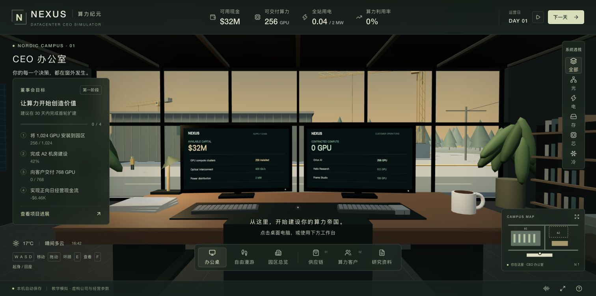
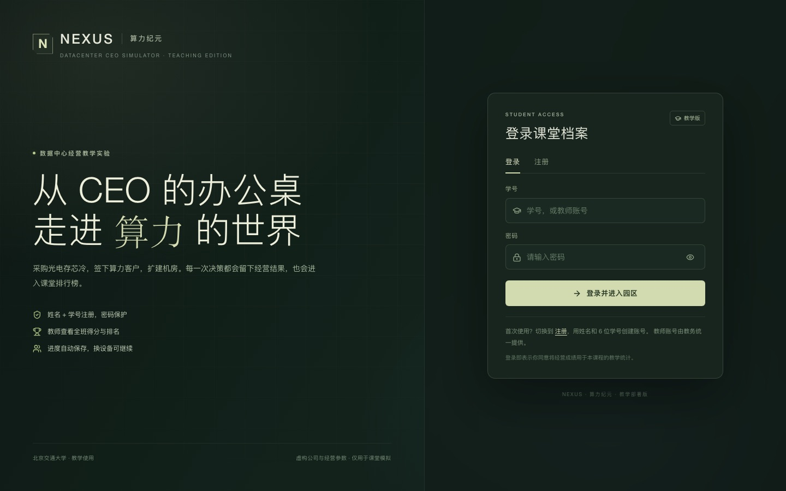
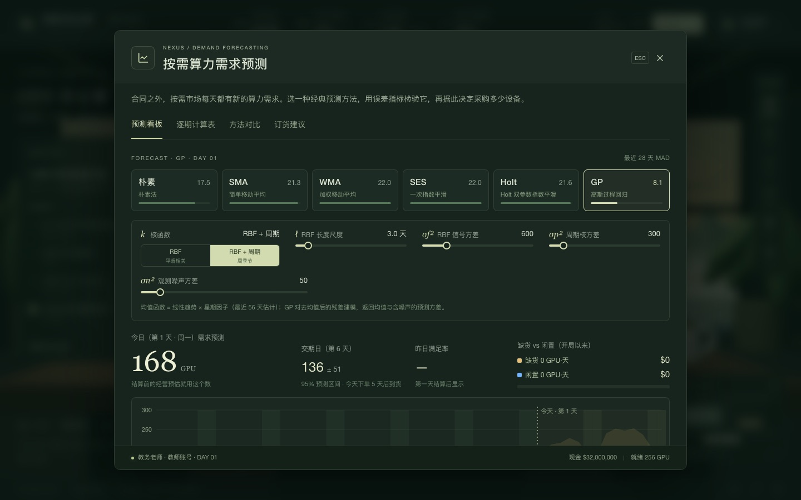
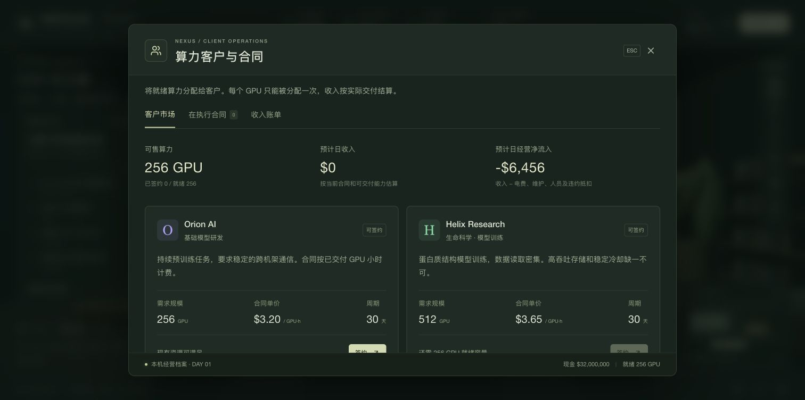
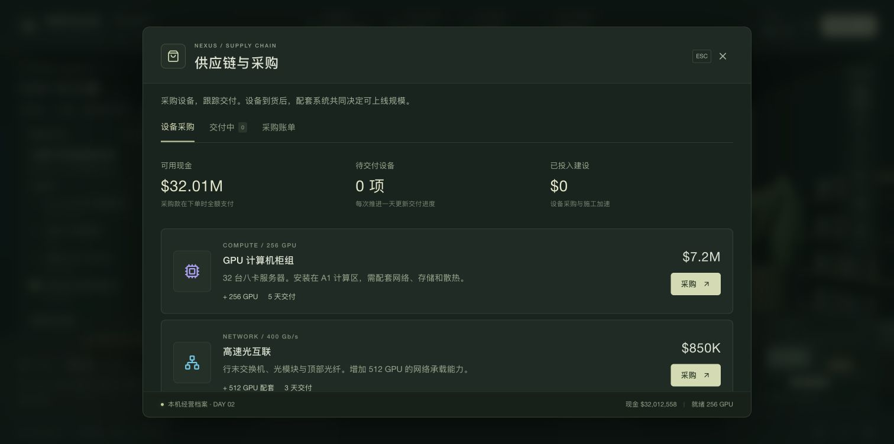

<div align="center">

# NEXUS · 算力纪元

**从 CEO 的办公桌出发，经营一座真正需要「光、电、存、芯、冷」协同工作的数据中心。**

[在线试玩](https://bjtu.echoxai.net/) · [备用入口](http://120.26.147.100:8080/) · [中文教程](docs/TUTORIAL.md) · [阿里云部署](docs/ALIYUN.md) · [教程文件](docs/videos/README.md) · [English](README.en.md)

> 请使用完整的 **https://** 地址访问；`http://` 会被阿里云备案拦截页挡住，这是域名备案限制，不是游戏故障。



[](LICENSE)
[](https://github.com/luvio-arlan/DC-Taech/actions/workflows/ci.yml)

</div>

你面前的左屏是供应链，右屏是算力客户。落地窗外，塔吊正在建设下一期机房。走进园区，看看 GPU 装在哪里，数据怎样流动，电力和冷却怎样支撑客户任务。

NEXUS 是一款 **第一人称 3D 数据中心经营教学游戏**。从 256 GPU 起步，签客户、采购设备、推进建设、处理故障，再把就绪算力转化成持续的经营现金流。

## 可以玩什么

- **CEO 办公室**：双电脑、可查看的施工图与桌面资料、窗外施工现场。
- **真实 3D 场景**：办公室自由走动、园区俯瞰、机房内部近看。
- **五大系统透视**：光互联、供配电、数据存储、GPU 计算和液冷散热。
- **模拟经营**：即时付款的采购、数日交付的设备、不可重复售卖的合同、逐客户账单。
- **建设与运维**：A2 机房进度、扩容瓶颈、冷却故障、应急维修。
- **账号与云端存档**：学生用姓名 + 6 位学号注册；进度同时保存在本机与教学服务器，教师可查看成绩排名。

## 课堂账号

| 角色 | 登录方式 | 说明 |
| --- | --- | --- |
| 学生 | 姓名 + **6 位纯数字学号** + 自设密码 | 首次使用先注册，登录后自动同步经营进度 |
| 教师 | `jiaowen` / `bjtu888` | 首次登录后请在右上角账号菜单修改密码 |

教师账号可打开「教师后台」，按最佳得分查看全班排名、搜索学生、导出 CSV，并重置个别学生的云端进度。排行榜取每位学生的历史最佳成绩，评分规则在游戏内「排行榜」页可见。



## 两分钟上手

1. 打开 **算力客户**，先签 Orion AI 的 **256 GPU** 合同。
2. 点 **下一天**，到 **收入账单** 看第一笔算力收入。
3. 在 **供应链** 采购 GPU 与配套，关注现金余额和交付日期。
4. 打开 **园区总览**，依次选择右侧的 **光、电、存、芯、冷**。
5. 在 **查看项目进展** 中检查最短缺的配套；GPU 到货并不代表它们都能上线。

董事会目标：A2 完成建设、安装至少 **1,024 GPU**、向客户交付至少 **768 GPU**、日经营现金流为正、现金余额大于零。**30 天是建议目标，之后仍可继续经营。**

[阅读完整新手教程与通关示例 →](docs/TUTORIAL.md)

## 教学扩展：需求预测

本仓库在原版基础上加入了一个**按需算力市场**，以及需求预测与不确定性量化模块：朴素法、简单移动平均、加权移动平均、一次指数平滑、Holt、高斯过程回归（GP）。游戏内可以看到：

- 误差指标 MAD、MSE、MAPE，以及跟踪信号 TS
- 逐期计算表，并可导出 CSV
- 六种方法在同一窗口下的对比
- GP 的后验均值、预测标准差与 95% 预测区间
- 产能版的订货建议



详见 [需求预测教学说明](docs/FORECAST.md)。

## 游戏画面

| 客户与合同 | 供应链与采购 |
| --- | --- |
|  |  |

更多画面见 [截图目录](docs/images/)。两个中文字幕配音图解视频见 [视频教程](docs/videos/README.md)。画面均来自实际游戏，经营日期在画面中保留。

## 操作

| 功能 | 操作 |
| --- | --- |
| 起身／回座 | **F** |
| 自由移动 | **W A S D** |
| 环顾 | 拖动鼠标或方向键 |
| 查看准星前物件 | **E**，也可以直接点击物件 |
| 打开工作台／切换场景 | 底部导航 |
| 结算当前日并推进一天 | 右上角 **下一天** |
| 自动推进 | 播放按钮，每 18 秒一天；打开面板时暂停 |

建议使用桌面浏览器并启用 WebGL 2。触屏设备支持拖动环顾和工作台导航。进度会同时写入本机浏览器和教学服务器；清除网站数据后，用同一学号登录即可从云端恢复。

## 本地运行

需要 **Node.js 24 LTS**（或 22.13+）。

```bash
git clone https://github.com/luvio-arlan/DC-Taech.git
cd DC-Taech
npm ci
npm run dev
```

`npm run dev` 会同时启动 Vite（<http://127.0.0.1:5173>）和教学服务（8787），首次运行自动创建 `data/nexus.db` 与教师账号。

```bash
npm test       # 经营规则、需求预测、账号与排名接口测试
npm run build  # TypeScript 检查 + 生产构建
npm start      # 生产模式：Node 同时托管 dist 和 /api
npm run backup # 备份 SQLite
```

项目使用 **React 19 + Three.js + Vite**，不需要 OpenAI、Nebius、Cloudflare 账号或 API Key。账号与成绩由 Node 内置的 `node:sqlite` 保存，没有外部数据库服务。

```bash
cp .env.example .env
docker compose up -d --build
```

详见 [部署指南](docs/DEPLOYMENT.md) 与 [阿里云部署记录](docs/ALIYUN.md)。

## 代码结构

- `app/scene.tsx`：3D 场景、相机、漫游与物件交互。
- `app/page.tsx`：经营工作台、合同、采购、账单和研究资料。
- `app/auth-gate.tsx`：登录、注册、修改密码界面。
- `app/ranking-panel.tsx`、`app/teacher-panel.tsx`：学生排行榜与教师后台。
- `lib/game.ts`：经营状态、容量约束、日结算与胜利条件。
- `lib/api.ts`：前端账号与成绩接口。
- `server/`：Node 教学服务、SQLite 数据库、会话与权限、静态文件托管。
- `shared/scoring.js`：前后端共用的评分规则。
- `tests/`：经营规则、需求预测、账号/排行/导出接口测试。
- `docs/`：新手教程、部署、截图、视频和对外介绍。

## 这是教学模型

**公司、客户、价格、工期和经营参数均为虚构。** 网络、存储与冷却简化为可支持的 GPU 数量；日经营现金流不含资本采购，也不等于会计净利润。设备按教学比例建模。

研究资料引用 Nebius 与 NVIDIA 官方公开页面，来源可在游戏内和 [资料说明](docs/SOURCES.md) 中查看。NEXUS 不是 Nebius 官方产品，引用不代表授权、合作或背书，也不是其真实园区复刻。

## 参与与分享

欢迎提交 [Issue](https://github.com/luvio-arlan/DC-Taech/issues) 反馈体验。对外介绍与英文简介见 [分享文案](docs/SHARE.md)。

本项目基于 [B-M-Capital-Research/nexus-datacenter-ceo](https://github.com/B-M-Capital-Research/nexus-datacenter-ceo) 的教学版本扩展，采用 [MIT License](LICENSE)。依赖和组件的原始版权见 [第三方许可说明](THIRD_PARTY_NOTICES.md)。
