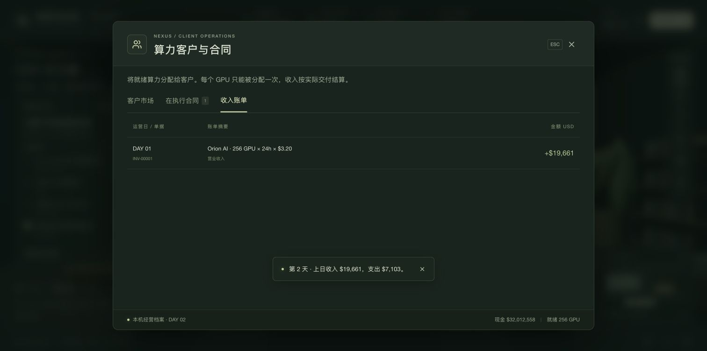
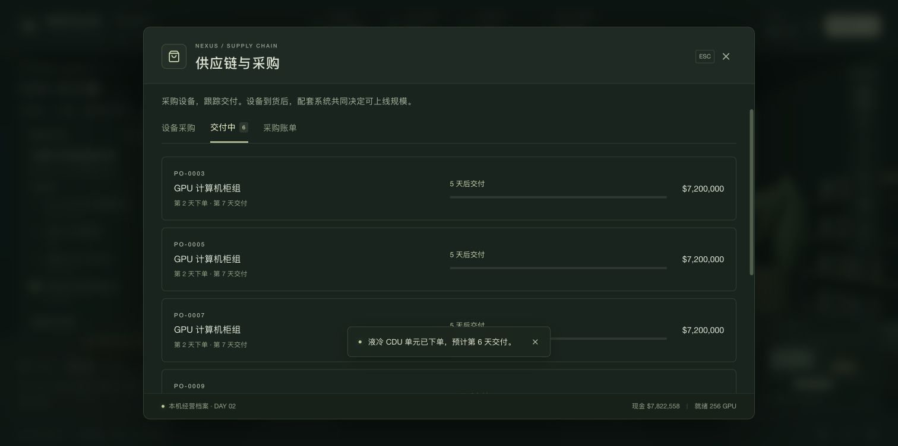

# 第一轮经营：从 256 GPU 到可交付算力园区

## 0. 先登录课堂

打开教学部署地址，用 **姓名 + 6 位纯数字学号 + 自设密码** 注册学生账号。登录后，经营进度会自动保存到教学服务器；换一台电脑用同一学号登录即可继续。教师账号由教务提供。

## 1. 先签客户

进入游戏后，点击右侧电脑或底部的「算力客户」。签下 Orion AI：需求 256 GPU、单价 $3.20/GPU·h、合同期 30 天。

签约会预留算力。回到办公室点「下一天」，先结算当前日，再进入新一天。在「算力客户 → 收入账单」可以看到按客户记录的第一笔收入。



## 2. 采购一整套系统

「供应链」列出 GPU、光网络、供配电、存储和液冷设备。GPU 每批 64 张，可以一次采购多批。点击采购会立即支付全款，设备按运营日交付。采购后到「交付中」查看预计到货日期。



有钱也不要只买 GPU。可交付数量取决于：

```
min(已安装 GPU, 光网络, 存储, 冷却, 电力预算, 机房空间)
```

## 3. 把采购对应到真实位置

进入「园区总览」，用右侧按钮打开剖面：

| 系统 | 场景位置 | 作用 |
| --- | --- | --- |
| 光 | 机柜顶部走线架、行末交换机 | 连接计算节点；机架内部分连接仍是铜缆 |
| 电 | 东侧变电站、配电线路与机柜母排 | 从电网到服务器，预留全站负荷 |
| 存 | 西侧存储柜、服务器本地缓存 | 供应训练数据、保存模型检查点 |
| 芯 | 中央计算柜中的服务器托盘 | 执行训练或推理任务 |
| 冷 | 机柜后部、行旁 CDU、室外换热区 | 带走热量，避免算力降额 |

## 4. 建设与故障

A2 初始进度 42%，每过一天增加 4%。一次 $350,000 的施工加速立刻增加 12%。完成后，空间预算从 512 GPU 增至 4,096 GPU；其他配套仍然会限制实际容量。

第 12 天，冷却能力减半。你可以支付 $120,000 接入备用 CDU，或等待第 16 天常规恢复。交付不足会减少收入，并带来服务抵扣。

## 5. 一条可复现的新手路线

这是一条教学示例，不是唯一解：

1. 第 1 天签 Orion AI，然后结算一天。
2. 第 2 天采购 **12 批 GPU**（每批 64 张，可在采购卡片上把批数调到 12 一次下单）、**1 组光互联**、**1 组并行存储**、**1 组液冷 CDU**。总建设采购支出 $24.19M。
3. 逐日推进。到第 7 天，以上设备均已到货；A2 尚未交付时，空间预算仍是 512 GPU。
4. 第 12 天处理冷却故障，并付费加速施工一次。
5. 进入第 13 天，A2 完工且配套齐备，签下 Helix Research 的 512 GPU 合同。
6. 合计交付 768 GPU，检查董事会目标与日经营现金流。

视频素材按这条路线在实际游戏中操作拍摄。日期和现金随你的选择不同而变化。30 天只是建议目标；合同会到期，持续经营时还要关注续约与利用率。

## 视频与图文

[中文字幕配音图解教程](videos/README.md) 使用实际游戏截图、旁白和字幕解释关键步骤；不是连续不间断的游玩录像。

所有公司、价格、客户与经营参数均为虚构教学设定，不能用于真实采购报价或公司估值。
